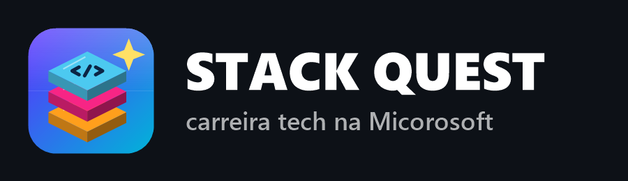

# Stack Quest: carreira tech na Micorosoft



Jogo educativo para Windows em que você é estagiário(a) da **Micorosoft**, uma paródia da Microsoft. Você anda por um escritório em visão isométrica, conversa com as pessoas e resolve desafios reais de tecnologia digitando o comando ou o código certo no terminal, na IDE, no console AWS ou no MySQL de cada área.

- **918 desafios** em 9 áreas: Docker, Redes, AWS, SQL, Python, PHP, HTML/CSS/JS, React e Flutter (102 por área, em três níveis: Iniciante, Intermediário e Profissional).
- Biblioteca de documentação dentro do jogo, badges, carreira, lojinha, fome e sede, sala do jogador com parede da fama e minijogos.

## Jogar
Baixe [`StackQuest-alunos.zip`](StackQuest-alunos.zip), extraia e abra o `StackQuest.exe`. Não precisa instalar nada: o jogo usa o .NET Framework 4 que já vem no Windows. As instruções estão no `COMO JOGAR.txt` dentro do zip.

## Compilar
Rode `build.bat` na pasta do projeto. Ele usa o compilador C# que já vem com o Windows (`csc.exe` do .NET Framework 4.x) e gera o `StackQuest.exe`.

Autoteste (confere as respostas de todos os desafios):

```
%WINDIR%\Microsoft.NET\Framework64\v4.0.30319\csc.exe /nologo /codepage:65001 /out:selftest.exe /main:DockerQuest.SelfTest /r:System.Windows.Forms.dll /r:System.Drawing.dll src\*.cs tests\SelfTest.cs
selftest.exe
```

## Mais detalhes
O guia completo para professores (áreas, controles, sistema de pontos, save, sala do jogador etc.) está em [LEIA-ME.md](LEIA-ME.md).
